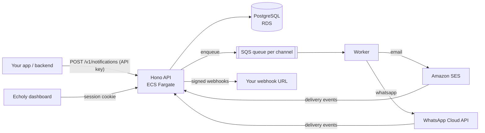

# Echoly

A multi-channel notification platform: send email and WhatsApp messages (SMS, push and in-app planned) from one API, with a dashboard to manage projects, templates, providers, delivery logs and analytics.

> **Status:** the dashboard is complete (runs on built-in demo data). The API is being built slice by slice; authentication, projects, API keys, users, permissions and the audit log are live. See [Status](#status).

**Live demo:** https://d3avkmp5sjysza.cloudfront.net  (sign-in is by emailed one-time code, so an admin must be set up first, see [Deployed demo](#deployed-demo))

---

## How it works



1. **Organizations and projects.** An organization has projects (one per client or product). Each project has `dev`, `staging` and `prod` environments, and each environment has its own API keys.
2. **Send.** Your app calls `POST /v1/notifications` with an API key, a template key, a recipient and data. An `Idempotency-Key` header prevents duplicate sends.
3. **Queue and deliver.** The API stores the notification and queues it. A worker renders the template, calls the provider (SES for email, Meta for WhatsApp), records every attempt, and retries with backoff. Messages that keep failing go to a dead-letter queue.
4. **Track.** Providers report delivered, read and failed events back. The dashboard shows status, a timeline, provider responses and analytics. Your app can receive the same events through signed webhooks.
5. **Control.** Roles decide who can see and do what, and every change is written to an audit log.

### Roles

| Role | Typical access |
|---|---|
| Main admin | Everything, including users, roles and the permission matrix |
| Manager | Their projects: members, limits, providers, keys, audit |
| Developer | Keys, templates, sending, logs, developer portal |
| Client | Overview, notifications, templates and email branding for their project |

The permission matrix is editable by the main admin. The server enforces it (the UI only hides things), and users are isolated to their own projects.

---

## Demo

### 1. Dashboard only (no backend, 1 minute)

Uses clearly labelled demo data from an in-browser mock.

```bash
cd web
npm install
npm run dev          # http://localhost:5173
```

On the login screen choose a demo role to see how the dashboard changes per role.

### 2. Dashboard with the real API

```bash
# database
docker run -d --name echoly-pg -e POSTGRES_USER=notify -e POSTGRES_PASSWORD=notify \
  -e POSTGRES_DB=notify -p 5432:5432 postgres:16

# API
cd server
cp .env.example .env
npm install
npm run seed         # migrations + demo org, project and users
npm run dev          # http://localhost:8787

# dashboard (second terminal): set VITE_USE_MOCK=false in web/.env.development
cd web && npm install && npm run dev
```

Sign in with `admin@example.com`. The one-time code is printed in the API console while `OTP_CONSOLE=true`. The demo-role buttons also work locally while `ENABLE_DEMO_LOGIN=true` (never enable this in production; the server refuses to start if you do).

---

## Deployed demo

The whole stack deploys to your own AWS account with one command (AWS CDK):

| Piece | AWS service |
|---|---|
| Dashboard (static site) | S3 + CloudFront (HTTPS) |
| API (`/internal/*`, `/v1/*`) | ECS Fargate behind an ALB, served through the same CloudFront domain, so no CORS |
| Database | RDS PostgreSQL (credentials in Secrets Manager) |
| Sign-in codes | SES |

```bash
cd infra
AWS_PROFILE=<your-profile> AWS_REGION=<region> ADMIN_EMAIL=you@example.com bash deploy.sh
```

The script builds the dashboard, bootstraps CDK, deploys, and prints the app URL (`AppUrl`). AWS emails a verification link to `ADMIN_EMAIL` (SES sandbox): click it once, then sign in with that address and the emailed code.

Approximate cost while running: about USD 35-45 per month (ALB, Fargate, RDS t4g.micro). Remove everything with `cd infra && npx cdk destroy`.

---

## Status

| Area | State |
|---|---|
| Dashboard: all pages (overview, notifications, templates, analytics, branding, workflows, schedules, channels, projects, developers, logs, security/admin) | Done, on demo data |
| API: auth (OTP + sessions), roles and permission matrix, projects, environments, API keys, users, audit log | Done |
| AWS deployment (CDK) | Done |
| API: notifications + SQS worker + SES sending | Next |
| API: templates, schedules, channels/providers, webhooks, logs, analytics, branding | Planned |
| WhatsApp via Meta Cloud API | Planned |
| SMS, push, in-app, recurring schedules, workflow engine, cost estimates, bulk campaigns | Later (shown as "Pending" in the UI) |

## Repository layout

```
web/      React 19 + Vite + TypeScript + Tailwind + shadcn/ui + TanStack Router/Query
server/   Hono (Node.js, plain JavaScript) + PostgreSQL; SQL migrations in src/db/migrations
infra/    AWS CDK stack (VPC, RDS, ECS Fargate + ALB, S3 + CloudFront, SES)
```

More detail: [`web/README.md`](web/README.md), [`server/README.md`](server/README.md).

## Security notes

- API keys are shown once and stored hashed; provider secrets are never returned by the API.
- Sessions are httpOnly cookies; OTP codes are hashed, expire in 10 minutes and are rate limited.
- RBAC and project isolation are enforced on the server for every request.
- Demo login is disabled in production by design.
